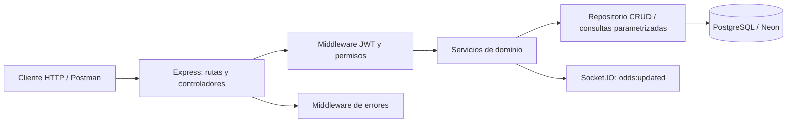
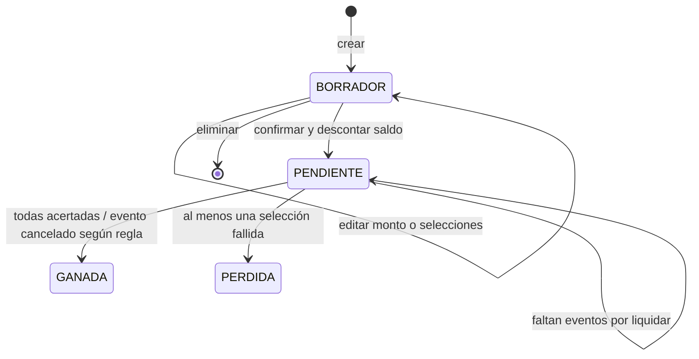
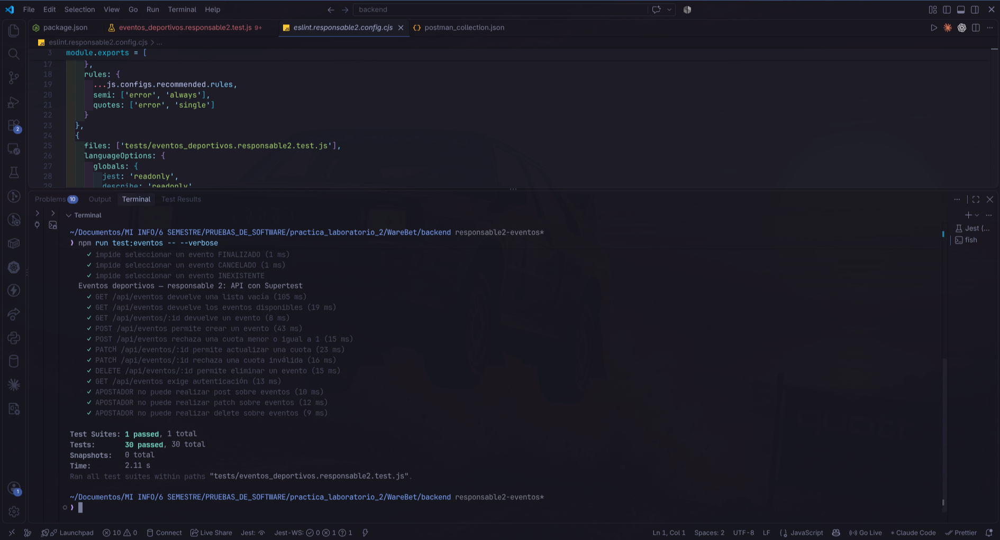
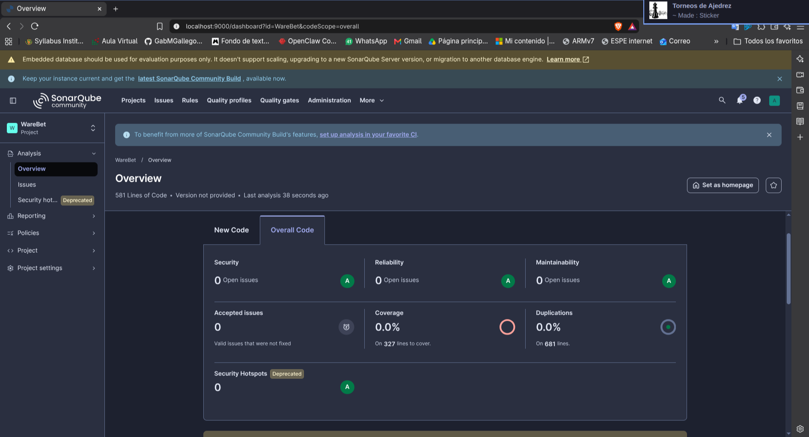

# WareBet — Presentación académica del proyecto

> **Guion de exposición:** cada sección numerada equivale a una diapositiva. El documento describe el estado del repositorio y resume informes y evidencias existentes. Las cifras históricas de análisis y pruebas se identifican por su alcance para no presentarlas como una única ejecución actual.

---

## Diapositiva 1 — Portada

### WareBet: API para la gestión y simulación de apuestas deportivas

- **Tipo de proyecto:** aplicación académica de backend con API REST.
- **Dominio:** usuarios, eventos deportivos, apuestas y detalles de selección.
- **Tecnologías principales:** Node.js, Express, PostgreSQL, JWT, Jest, Supertest, ESLint y SonarQube.
- **Propósito de esta exposición:** explicar qué resuelve el sistema, cómo está organizado, cuáles son sus reglas, qué errores se encontraron y corrigieron, y qué evidencia existe de verificación.
- **Alcance económico:** utiliza créditos virtuales. El backend descrito no procesa pagos reales.

**Mensaje de apertura:** WareBet representa el ciclo completo de una apuesta deportiva —desde el registro y la selección de eventos hasta la liquidación— usando una API con autenticación, permisos, persistencia relacional y pruebas automatizadas.

---

## Diapositiva 2 — ¿Qué problema aborda?

Gestionar apuestas deportivas implica coordinar información relacionada: quién apuesta, qué partidos están disponibles, qué pronósticos contiene una apuesta, qué cuotas se aplicaron y qué saldo corresponde después de confirmarla o liquidarla. Si esas operaciones se implementan por separado, pueden aparecer inconsistencias, por ejemplo descontar saldo dos veces o permitir una selección sobre un evento ya finalizado.

WareBet centraliza esas operaciones en un backend que aplica reglas comunes y protege las transiciones importantes con transacciones de PostgreSQL.

### Pregunta guía

> ¿Cómo construir un servicio que administre apuestas simuladas de manera coherente, controle quién puede realizar cada operación y conserve la integridad de los saldos y resultados?

---

## Diapositiva 3 — Propósito y objetivos

### Propósito general

Desarrollar y verificar una API REST para administrar un flujo académico de apuestas deportivas con créditos virtuales.

### Objetivos específicos

1. Registrar usuarios y autenticar sesiones mediante credenciales y tokens JWT.
2. Aplicar permisos según los perfiles `ADMIN`, `GESTOR` y `APOSTADOR`.
3. Administrar eventos, cuotas, marcadores, estados y resultados deportivos.
4. Crear apuestas simples y combinadas, calcular cuotas y premios potenciales, y confirmar apuestas con descuento de saldo.
5. Liquidar apuestas según los resultados, incluyendo devolución cuando un evento se cancela.
6. Mantener operaciones relacionadas dentro de transacciones para poder confirmar o revertir el conjunto de cambios.
7. Validar comportamiento con pruebas automatizadas y revisar calidad estática con ESLint y SonarQube.

---

## Diapositiva 4 — Alcance del sistema

### Incluido

- API HTTP en Express.
- Persistencia en PostgreSQL mediante `pg`.
- Integración prevista con una base PostgreSQL alojada en Neon.
- Gestión de cuatro entidades: usuarios, eventos deportivos, apuestas y detalles de apuestas.
- Autenticación y autorización por perfil.
- CRUD de recursos, reglas de apuestas, reportes y verificación de salud/esquema.
- Notificación en tiempo real de cambios de cuotas con Socket.IO.
- Pruebas de servicio y de rutas HTTP con Jest y Supertest; análisis con ESLint y SonarQube.

### Fuera del alcance demostrado por el código/documentación

- Cobros, retiros o dinero real.
- Interfaz web completa: este repositorio documenta principalmente el backend.
- Integración de una pasarela de pago.
- Pruebas automatizadas contra una base de datos real aislada. Las pruebas descritas simulan PostgreSQL para evitar modificar datos existentes.

---

## Diapositiva 5 — Usuarios y perfiles

| Perfil | Funciones principales | Límites relevantes |
|---|---|---|
| `ADMIN` | Administrar usuarios; consultar y administrar eventos, apuestas y reportes; inspeccionar el esquema. | Las acciones sobre apuestas todavía respetan reglas de estado y propiedad implementadas por los servicios. |
| `GESTOR` | Consultar eventos y apuestas; crear/modificar eventos; consultar reportes. | No tiene permiso para escribir apuestas ni administrar usuarios. |
| `APOSTADOR` | Consultar eventos; crear, editar, confirmar y eliminar sus borradores; consultar sus apuestas y detalles; gestionar su perfil. | Solo accede a sus apuestas y no puede administrar eventos ni consultar reportes. |

Los perfiles del sistema describen permisos de aplicación; no deben confundirse con la distribución académica del trabajo por responsables o tablas.

---

## Diapositiva 6 — Modelo de datos conceptual

El backend consume cuatro tablas existentes. El servidor inspecciona la base al arrancar, pero el README indica que **no crea ni altera el esquema**.

| Tabla | Identificador | Función | Relaciones descritas |
|---|---|---|---|
| `usuarios` | `id_usuario` | Identidad, correo, hash de contraseña, perfil, saldo virtual y opciones de menú. | Un usuario puede tener varias apuestas. |
| `eventos_deportivos` | `id_evento` | Deporte, competencia, equipos, fecha, cuotas, marcadores, resultado y estado. | Un evento puede aparecer en varios detalles de apuesta. |
| `apuestas` | `id_apuesta` | Usuario propietario, tipo, monto, cuota total, premio potencial, estado y fechas. | Pertenece a un usuario y reúne detalles. |
| `detalle_apuestas` | `id_detalle` | Evento y selección pronosticada, cuota fijada y estado de esa selección. | Vincula una apuesta con un evento. |


El detalle guarda la cuota `cuota_fijada` al momento de crear o cambiar la selección. Así, una modificación posterior de la cuota del evento no recalcula retroactivamente esa selección ya guardada.

---

## Diapositiva 7 — Arquitectura técnica



### Capas del backend

- **`src/app.js`:** configura Express, rutas, controles de entrada, autorización y respuestas HTTP.
- **`src/controllers/authController.js`:** registro, inicio/cierre de sesión lógica, perfil, cambio de contraseña y menú.
- **`src/services/bettingService.js`:** reglas de borradores, confirmación, detalles y liquidación.
- **`src/repositories/crudRepository.js`:** operaciones CRUD reutilizables para recursos permitidos.
- **`src/utils/sql.js`:** catálogo de tablas/campos permitidos y filtrado de propiedades.
- **`src/middlewares/auth.js`:** validación JWT y permisos por perfil.
- **`src/middlewares/errors.js`:** convierte errores de negocio y PostgreSQL en respuestas HTTP.
- **`src/config/db.js`:** pool y consultas PostgreSQL, junto con inspección del esquema.
- **`src/server.js`:** configuración y arranque del servidor, verificación de conexión y cierre ordenado.

---

## Diapositiva 8 — Tecnologías y herramientas

| Área | Tecnología | Uso en el proyecto |
|---|---|---|
| Runtime | Node.js, JavaScript CommonJS | Ejecución del backend. El README solicita Node.js 20 o superior. |
| API | Express 4 | Rutas REST y middleware. |
| Base de datos | PostgreSQL, paquete `pg`, Neon | Persistencia relacional y transacciones. |
| Seguridad de sesión | `jsonwebtoken`, `bcryptjs` | JWT y hash de contraseñas. |
| Protección HTTP | `helmet`, CORS, `express-rate-limit` | Encabezados, acceso entre orígenes y limitación de solicitudes. |
| Comunicación en vivo | Socket.IO | Emitir `odds:updated` cuando cambian cuotas. |
| Validación | `express-validator` y validaciones de dominio | Validación de entradas según rutas/servicios. |
| Pruebas | Jest, Supertest, `node:test` | Casos del dominio y solicitudes HTTP. |
| Calidad estática | ESLint y SonarQube | Estilo, patrones de mantenibilidad y seguimiento de incidencias. |
| Consumo manual | Colección Postman | Solicitudes de ejemplo para explorar la API. |

---

## Diapositiva 9 — Seguridad y acceso a la API

1. El cliente se registra o envía credenciales a `POST /api/auth/login`.
2. El servidor compara la contraseña con su hash y entrega un JWT.
3. Las rutas privadas reciben `Authorization: Bearer <token>`.
4. El middleware verifica el token y coloca el perfil/identidad en la solicitud.
5. El middleware de autorización contrasta el perfil con el permiso de la ruta.
6. Las rutas filtran los datos de apostadores por su `id_usuario`; los hashes de contraseña se excluyen de las respuestas seguras.

### Respuestas comunes

- `200`: lectura o modificación completada.
- `201`: recurso creado.
- `400`: entrada o regla de negocio inválida.
- `401`: falta el token o las credenciales/token no son válidos.
- `403`: perfil sin autorización.
- `404`: recurso o ruta no encontrada; también se usa para ocultar apuestas ajenas a un apostador.
- `409`: conflicto, por ejemplo correo duplicado, saldo insuficiente en ciertos flujos o estado incompatible.
- `500`: error interno; la respuesta general evita exponer detalle en producción.
- `503`: la ruta de salud no logra consultar la base de datos.

Los códigos pueden depender del flujo concreto; las pruebas y los servicios son la referencia para cada caso particular.

---

## Diapositiva 10 — Rutas REST principales

| Grupo | Rutas | Operaciones |
|---|---|---|
| Salud/esquema | `GET /api/health`, `GET /api/schema` | Estado de API/base; inspección de esquema para ADMIN. |
| Autenticación/perfil | `POST /api/auth/register`, `POST /api/auth/login`, `GET/PATCH /api/auth/me`, `PATCH /api/auth/password`, `GET /api/menu` | Registro, token, perfil, clave y menú por perfil. |
| Usuarios | `GET/POST /api/usuarios`, `GET/PATCH/DELETE /api/usuarios/:id` | Administración restringida a ADMIN. |
| Eventos | `GET/POST /api/eventos`, `GET/PATCH/DELETE /api/eventos/:id` | Consulta de eventos y gestión por ADMIN/GESTOR. |
| Apuestas | `GET/POST /api/apuestas`, `GET/PATCH/DELETE /api/apuestas/:id` | Consulta, borrador, edición, confirmación y eliminación. |
| Detalles | `GET/POST /api/detalles`, `GET/PATCH/DELETE /api/detalles/:id`; `GET /api/apuestas/:id/detalles` | Administración de selecciones y consulta por apuesta. |
| Reportes | `GET /api/reportes` | Métricas generales para ADMIN/GESTOR. |

Salvo registro, login y health, las rutas requieren autenticación. Las cuatro listas CRUD documentadas admiten `limit` y `offset`; el límite normal se acota a 200 registros.

---

## Diapositiva 11 — Ciclo de vida de un evento

### Estados y resultados

- Un evento puede estar `PROGRAMADO`, `EN_VIVO`, `FINALIZADO` o `CANCELADO` según el flujo.
- Solo eventos `PROGRAMADO` o `EN_VIVO` pueden elegirse en apuestas.
- Al finalizar, se requiere un resultado válido o marcadores enteros no negativos para calcularlo: `LOCAL`, `VISITANTE` o `EMPATE`.
- Un evento cancelado no necesita marcadores y sus selecciones pendientes se anulan.
- Una actualización de cuotas válida emite `odds:updated` por Socket.IO.
- Cambiar el estado a finalizado/cancelado inicia la liquidación de los detalles pendientes relacionados.

### Validación de cuotas

Las cuotas locales, empate y visitante deben ser numéricas, finitas y mayores que 1 en las rutas de alta/edición descritas por la implementación y sus pruebas.

---

## Diapositiva 12 — Ciclo de vida de una apuesta



### Reglas de negocio

- Tipos disponibles: `SIMPLE` (exactamente una selección) y `COMBINADA` (dos o más).
- El monto debe ser numérico y mayor que cero.
- No se permite repetir un mismo evento en las selecciones al crear o reemplazar el conjunto completo.
- Las selecciones admitidas son `LOCAL`, `EMPATE` y `VISITANTE`.
- `cuota_total` es el producto de las cuotas fijadas de las selecciones.
- `premio_potencial` es `monto × cuota_total`.
- Crear un borrador no descuenta saldo; confirmar verifica de nuevo el saldo, lo descuenta y lleva la apuesta a `PENDIENTE`.
- Solo se editan o eliminan apuestas que aún estén en `BORRADOR`.

---

## Diapositiva 13 — Transacciones e integridad

Las operaciones críticas siguen un patrón común: abrir conexión, iniciar transacción, bloquear las filas relevantes, validar reglas, ejecutar cambios, confirmar con `COMMIT` o revertir con `ROLLBACK`, y liberar la conexión.

### Ejemplo: confirmar apuesta

1. Bloquear y localizar la apuesta del usuario.
2. Verificar que exista y esté en `BORRADOR`.
3. Bloquear el saldo del usuario y comprobar que cubra el monto.
4. Descontar el monto y cambiar la apuesta a `PENDIENTE`.
5. Confirmar ambas modificaciones juntas.

### Ejemplo: liquidar evento

1. Bloquear el evento y validar que sea finalizado o cancelado.
2. Calcular o conservar el resultado; actualizar detalles todavía pendientes.
3. Esperar a que no queden detalles pendientes de una apuesta combinada.
4. Marcar la apuesta como ganada/perdida y acreditar premio o devolver el monto cuando corresponda.
5. Confirmar todos los cambios en una transacción.

Este diseño reduce el riesgo de dejar el detalle actualizado pero la apuesta o el saldo sin actualizar. Las pruebas simuladas verifican llamadas a `COMMIT` y `ROLLBACK`; no equivalen a una prueba de concurrencia con PostgreSQL real.

---

## Diapositiva 14 — Ejemplo integral de uso

### Solicitud para crear un borrador simple

```http
POST /api/apuestas
Authorization: Bearer <JWT>
Content-Type: application/json
```

```json
{
  "tipo": "SIMPLE",
  "monto": 25,
  "selecciones": [
    { "id_evento": 1, "seleccion": "LOCAL" }
  ]
}
```

La respuesta de creación es `201` y el borrador contiene cuota/premio potencial calculado. Después se confirma con:

```http
PATCH /api/apuestas/123
Authorization: Bearer <JWT>
Content-Type: application/json
```

```json
{ "confirmar": true }
```

Si el evento termina, la gestión de eventos dispara el cálculo de resultado y la liquidación correspondiente. Para una combinada, el premio solo se determina cuando todos los detalles han dejado de estar pendientes.

---

## Diapositiva 15 — Errores y problemas corregidos

Esta tabla reúne defectos funcionales y hallazgos de calidad que aparecen en los informes del repositorio. ESLint/Sonar identifican clases distintas de problemas: un *code smell* no implica por sí mismo un fallo funcional.

| Área | Problema encontrado | Corrección documentada | Cómo se verificó |
|---|---|---|---|
| Eventos | Se aceptaban marcadores negativos, decimales, texto o no finitos para calcular resultado. | Validar cada marcador como entero no negativo antes de calcular; revertir transacción si falla. | Pruebas de servicio para marcadores inválidos y rollback. |
| Eventos | `POST /api/eventos` podía insertar una cuota menor o igual a 1; `PATCH` ya tenía validación. | Validar las cuotas proporcionadas antes del `INSERT`; responder `400` sin ejecutar persistencia. | Supertest comprueba `400` y ausencia de consulta. |
| Pruebas de eventos | Comparaciones rígidas de SQL fallaban por diferencias inocuas de espacios. | Cambiar expectativas a expresiones regulares que toleran espacios sin dejar de comprobar parámetros. | La línea base funcional se estableció en 25 aprobadas y 5 fallidas; después 30/30 aprobadas. |
| Apuestas | `createDraft` podía recibir `selecciones: null` o un tipo no arreglo y acceder a su longitud. | Comprobar `Array.isArray` antes de reglas de cardinalidad. | Caso explícito para `null`, con rechazo `400`. |
| Apuestas/usuarios | Confirmación podía ser difícil de mantener por condiciones compactas; liquidación tenía alta complejidad y cálculo de pago con ternarios anidados. | Separar validaciones/cálculo de pago y extraer helpers de resultado, estado, liquidación y pago. | Suite de apuestas; análisis Sonar documentó las correcciones por alcance. |
| SQL común | Plantillas SQL contenían expresiones literales anidadas. | Preparar por separado columnas, placeholders y asignaciones; mantener valores parametrizados. | Pruebas CRUD y análisis Sonar. |
| Usuarios | Operaciones relacionadas requerían reglas seguras sobre hash, perfil, correo y saldo. | Las validaciones de registro/perfil ocultan `clave_hash`, normalizan correo y restringen campos protegidos; los informes corrigen issues compartidos del CRUD/liquidación. | Suite de usuarios y revisión Sonar de alcance usuarios. |
| Estilo | ESLint detectó errores de formato y reglas como `prefer-const`, variables no usadas, comillas y punto y coma. | Aplicar formato y corregir referencias no utilizadas o mal declaradas; configurar reglas por responsable. | Los informes de responsables documentan ejecuciones posteriores sin errores/advertencias. |

### Errores funcionales concretos de la línea base de eventos

El informe del responsable 2 documenta **cinco fallos iniciales relevantes**: cuatro casos inválidos de marcadores y una creación de evento con cuota inválida. Tras la corrección, la suite de eventos aprobó sus 30 casos.

---

## Diapositiva 16 — Estrategia de pruebas

### Herramientas y alcance

- **Jest:** organiza suites, prepara casos, mocks y aserciones.
- **Supertest:** envía solicitudes HTTP a Express sin desplegar el servidor como servicio externo.
- **Mocks de PostgreSQL:** `jest.mock('../src/config/db')` sustituye `pool` y `query`; evita escribir en Neon.
- **Mock de JWT en varias suites:** permite definir perfiles y tokens de prueba mientras se evalúan rutas y permisos.
- **`node:test`:** conserva una suite unitaria original (`tests/unit.test.js`).
- **ESLint:** revisión estática; no sustituye pruebas de comportamiento.
- **SonarQube:** análisis estático y seguimiento de code smells; la cobertura depende de importar/obtener un reporte compatible.

### Archivos de prueba actuales

| Archivo | Área que cubre |
|---|---|
| `tests/usuarios_validacion.test.js` | Registro, login, correo/contraseña, privacidad, perfiles, menú, administración y cambio de contraseña. |
| `tests/eventos_deportivos.responsable2.test.js` | Resultado por marcadores, validaciones, disponibilidad de eventos, rutas CRUD, cuotas y permisos. |
| `tests/apuestas.responsable3.test.js` | Borradores, confirmación, edición, eliminación, liquidación, repositorio, middleware y rutas HTTP. |
| `tests/detalle_apuestas.validacion.test.js` | Propiedad, estado de borrador, eventos/selecciones válidas y cardinalidad mínima. |
| `tests/unit.test.js` | Menú base y filtrado de campos no permitidos con `node:test`. |

---

## Diapositiva 17 — Casos de prueba representativos

### Usuarios

- Rechazar registro incompleto o contraseña menor de ocho caracteres.
- Normalizar correo y aplicar valores seguros al registrar.
- Responder conflicto ante correo duplicado.
- Iniciar sesión sin exponer `clave_hash`.
- Exigir autenticación y restringir administración de usuarios a ADMIN.
- Ocultar datos de otros usuarios y proteger campos del perfil propio.
- Cambiar contraseña dentro de una transacción y revertir si la clave actual es incorrecta.

### Eventos

- Convertir marcador local/visitante en `LOCAL`, `VISITANTE` o `EMPATE`.
- Rechazar marcador nulo, ausente, negativo, decimal, texto o no finito.
- No liquidar eventos aún `PROGRAMADO` o `EN_VIVO`.
- Aceptar cancelación sin marcadores y conservar resultado ya guardado.
- Prohibir selección de eventos finalizados, cancelados o inexistentes.
- Comprobar lecturas, creación, actualización, borrado, cuotas y denegación de permisos.

### Apuestas y detalles

- Crear apuesta `SIMPLE`/`COMBINADA`, multiplicar cuotas y calcular premio.
- Rechazar tipo/monto/cardinalidad/selección inválidos, eventos repetidos, eventos cerrados y saldo insuficiente.
- Confirmar y debitar saldo; validar rechazo de apuesta inexistente/no borrador/saldo insuficiente.
- Comprobar edición y borrado solo en borrador, con `ROLLBACK` ante error.
- Liquidar ganadas, perdidas y anuladas; acreditar premio, no pagar pérdidas y reembolsar cancelaciones.
- Impedir que apostadores consulten apuestas/detalles ajenos y que una eliminación deje una apuesta sin selecciones requeridas.

---

## Diapositiva 18 — Resultados de verificación documentados

> Las cifras de esta diapositiva proceden de informes/capturas existentes y corresponden a ejecuciones y alcances identificados. No se suman como si fueran una ejecución consolidada de toda la suite actual.

| Revisión reportada | Resultado registrado | Alcance y cautela |
|---|---|---|
| Pruebas de apuestas | **32 aprobadas, 0 fallidas** | Suite `apuestas.responsable3.test.js` en el informe de validación del responsable 3. El mismo informe registró 90.02% sentencias, 84.24% ramas, 90.47% funciones y 99.31% líneas para sus archivos de cobertura. |
| Pruebas de eventos | **30 aprobadas, 0 fallidas**; además, **2 pruebas originales aprobadas** | Resultado reportado por el responsable 2; base previa válida de 25 aprobadas y 5 fallidas. El reporte Sonar de esa revisión mostró cobertura 0.0%, por lo que no se debe atribuir a ese análisis la cobertura Jest. |
| Suite de detalles | Se conserva una suite con casos de validación y acceso | Archivo actual `detalle_apuestas.validacion.test.js`; los informes consultados no ofrecen aquí un total consolidado final que se pueda atribuir con precisión. |
| Suite de usuarios | Se conserva suite de registro/autenticación/privacidad/perfil | Archivo actual `usuarios_validacion.test.js`; no se atribuye un total de ejecución final en esta presentación. |
| ESLint de eventos | **47 errores iniciales** de estilo; ejecución final sin incidencias reportadas | Configuración y archivos específicos del responsable 2. |
| ESLint de apuestas | **3 errores iniciales** corregidos; informe posterior registra **0 errores y 0 advertencias** | Alcance de archivos configurado para apuestas. |
| SonarQube — análisis general histórico | **29 issues abiertos → 0** en una revisión documentada; 0 bugs, 0 vulnerabilidades y 0 duplicación | Corresponde al análisis/reanálisis general descrito en `documentacion/Informe_SonarQube.md`. Quality Gate figuró `ERROR` por cobertura nueva 0.0% frente al umbral de 80%; por tanto no se declara Quality Gate aprobada. |
| SonarQube — revisión posterior de usuarios | **6 issues de alcance usuarios cerrados; 22 issues del backend aún abiertos** | Un informe posterior delimita el trabajo a usuarios y deja issues de apuestas/eventos/detalles fuera de alcance. No contradice necesariamente el conteo histórico: son revisiones y alcances distintos. |

### Interpretación académica

- Una prueba aprobada demuestra el comportamiento cubierto por ese caso y por los mocks usados.
- Las cifras de cobertura solo corresponden a la ejecución y a los módulos incluidos en el reporte citado.
- Que Sonar indique cero issues abiertos no significa que exista cobertura suficiente ni que la Quality Gate esté aprobada.
- No se afirma que estas suites se hayan ejecutado contra Neon o que se haya validado concurrencia real.

---

## Diapositiva 19 — Hallazgos de SonarQube en contexto

El informe general histórico clasifica sus 29 findings iniciales como code smells, no como bugs o vulnerabilidades. Los grupos reportados fueron:

- 18 expresiones de flujo/formato sin bloques explícitos (`javascript:S2681`).
- 4 ternarios anidados (`S3358`).
- 3 funciones con complejidad cognitiva alta (`S3776`).
- 3 plantillas de cadena anidadas (`S4624`).
- 1 recomendación de optional chaining (`S6582`).

En informes posteriores se documentan refactorizaciones: preparar SQL dinámico de forma más legible, separar la liquidación en funciones auxiliares, hacer explícito el cálculo del pago y ordenar las condiciones con bloques claros. La revisión delimitada a usuarios cierra los seis issues correspondientes a ese alcance, dejando 22 abiertos en áreas restantes.

### Resultado de calidad que debe comunicarse con precisión

En la captura/informe general, la Quality Gate quedó en `ERROR` por `new_coverage = 0.0%` frente a un umbral configurado de 80%. Esto es una condición distinta de los issues: el informe registró cero issues, pero la puerta no aparece aprobada.

---

## Diapositiva 20 — Ejecución y puesta en marcha

### Requisitos descritos

- Node.js 20 o superior.
- Una base PostgreSQL con las cuatro tablas esperadas.
- Variables de entorno `DATABASE_URL` y `JWT_SECRET`.
- Para crear el primer administrador: `ADMIN_NAME`, `ADMIN_EMAIL`, `ADMIN_PASSWORD`.

### Pasos desde `backend/`

```powershell
npm install
npm run dev
```

El servidor escucha normalmente en `http://localhost:3000`, configurable con `PORT`. Para el modo de producción:

```powershell
npm start
```

Para aprovisionar el administrador inicial:

```powershell
npm run create-admin
```

### Verificaciones disponibles (no ejecutadas como parte de la redacción)

```powershell
npm test
npm run test:unit
npm run test:eventos
npm run test:apuestas
npm run lint:eventos
npm run lint:apuestas
```

Los scripts específicos abarcan alcances diferentes. `npm test` ejecuta Jest con cobertura según la configuración actual del paquete; `test:unit` usa `node:test` aparte.

---

## Diapositiva 21 — Evidencias y documentos del repositorio

Material que respalda esta exposición:

- `backend/README.md`: configuración, rutas, flujo básico y límites de pruebas/base de datos.
- `documentacion/README.md`: descripción tecnológica del backend.
- `documentacion/Informe_SonarQube.md`: resumen histórico del análisis general y Quality Gate.
- `documentacion/APIS_POR_TABLA_Y_RESPONSABLE.md`: rutas, permisos y trabajo por tabla.
- `informe sobre errores/INFORME_SONARQUBE_WAREBET.md`: revisión general de hallazgos.
- `correccion de errores/`: informes de corrección para usuarios, eventos y detalles.
- `backend/Informe sobre validacion y verficiacion/INFORME_VALIDACION_Y_VERIFICACION_APUESTAS.md`: pruebas, ESLint y cobertura de la suite de apuestas.
- `evidencias_responsable2_eventos_deportivos/`: capturas de ejecuciones y revisión de eventos.
- `sonarqube errores encontrados/`: capturas del análisis SonarQube.
- `backend/postman_collection.json`: colección Postman importable.

Las capturas disponibles se pueden proyectar como apoyo visual: inicialización, fallos iniciales, corrección con ESLint, 30 pruebas de eventos aprobadas y análisis posterior.

### Capturas para insertar durante la exposición

**Resultado final de la suite de eventos (30 pruebas aprobadas):**



**Análisis SonarQube final de esa revisión de eventos:**



**Evidencia del análisis histórico y correcciones de calidad:**


---

## Diapositiva 22 — Limitaciones y trabajo futuro

### Limitaciones verificables

- Las pruebas automatizadas descritas se basan en mocks de consultas/conexiones; no confirman compatibilidad integral con datos reales de Neon.
- El esquema PostgreSQL se espera preexistente y el servidor no administra sus migraciones.
- Hay más de un conjunto de informes Sonar con fechas y alcances diferentes; sus conteos no se deben mezclar.
- El informe de 32 pruebas y cobertura de apuestas es específico de esa suite; no se presenta como cobertura total del producto.
- Las pruebas reportadas no establecen comportamiento bajo concurrencia real ni carga elevada.
- La evidencia disponible no demuestra una cobertura consolidada de todas las rutas y transiciones de todos los módulos.

### Mejoras futuras sugeridas

1. Crear una base de pruebas desechable con migraciones versionadas e integración automatizada.
2. Publicar un comando único de validación que ejecute todas las suites, linters y genere un reporte de cobertura consolidado.
3. Configurar SonarQube para importar LCOV y revisar una Quality Gate con métricas completas.
4. Añadir casos de concurrencia/idempotencia para confirmación, liquidación y cambios simultáneos de saldo.
5. Completar documentación de despliegue, variables, esquema y contrato OpenAPI.
6. Añadir validación uniforme de datos en rutas de alta y edición, además de restricciones correspondientes en base de datos.

---

## Diapositiva 23 — Conclusiones

- WareBet ofrece el backend de un sistema de apuestas deportivas de carácter simulado y académico.
- Su aporte central es conectar usuarios, eventos, selecciones, cuotas, estados y saldo mediante reglas de dominio y transacciones.
- La autorización por perfiles y el filtrado de propiedad forman parte del comportamiento de las rutas, no solo de la interfaz.
- Las pruebas disponibles cubren escenarios funcionales y HTTP para apuestas, eventos, detalles y usuarios, con ejecución simulada de PostgreSQL.
- Los informes registran correcciones funcionales y de calidad, pero las métricas deben presentarse con su alcance, fecha y herramienta.
- El resultado de SonarQube con cero issues en un análisis histórico no debe confundirse con una Quality Gate aprobada; la cobertura reportada en esa puerta fue cero.

### Cierre para exposición

> WareBet demuestra cómo organizar una API de dominio en capas y cómo proteger operaciones que afectan datos relacionados. La siguiente etapa académica sería validar el sistema contra una base aislada real y consolidar pruebas y cobertura de todos los módulos en una sola ejecución reproducible.

---

## Preguntas para la defensa

1. ¿Por qué la creación de una apuesta se modela primero como `BORRADOR`?
2. ¿Qué protege la transacción al confirmar una apuesta?
3. ¿Por qué se fija la cuota en el detalle en vez de leer siempre la cuota actual del evento?
4. ¿Cuándo se considera lista para liquidar una apuesta combinada?
5. ¿Cuál es la diferencia entre autenticación (`401`) y autorización (`403`)?
6. ¿Qué limitación tiene probar con una base de datos simulada?
7. ¿Por qué cero issues de Sonar no garantiza que la Quality Gate esté aprobada?
8. ¿Qué evidencia adicional se necesitaría para afirmar que el sistema funciona correctamente contra PostgreSQL real?

---

## Referencias internas del proyecto

- Código fuente: `backend/src/`.
- Pruebas: `backend/tests/`.
- Configuración y scripts: `backend/package.json` y `backend/README.md`.
- Documentación general y por responsable: `documentacion/`, `correccion de errores/`, `informe sobre errores/` y `backend/Informe sobre validacion y verficiacion/`.
- Capturas de verificación: `evidencias_responsable2_eventos_deportivos/` y `sonarqube errores encontrados/`.
