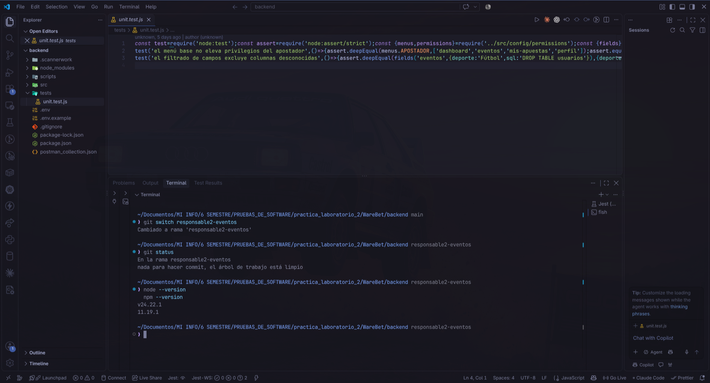
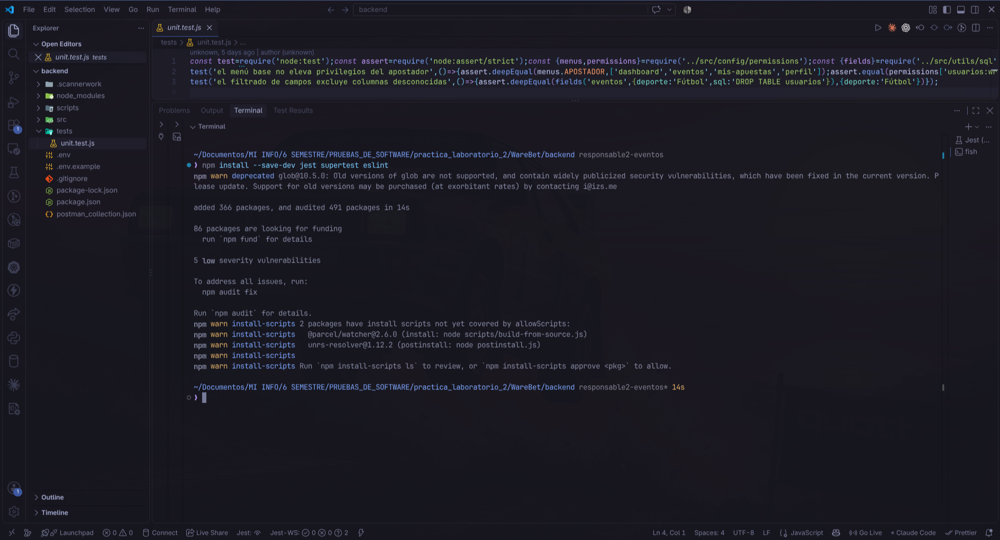
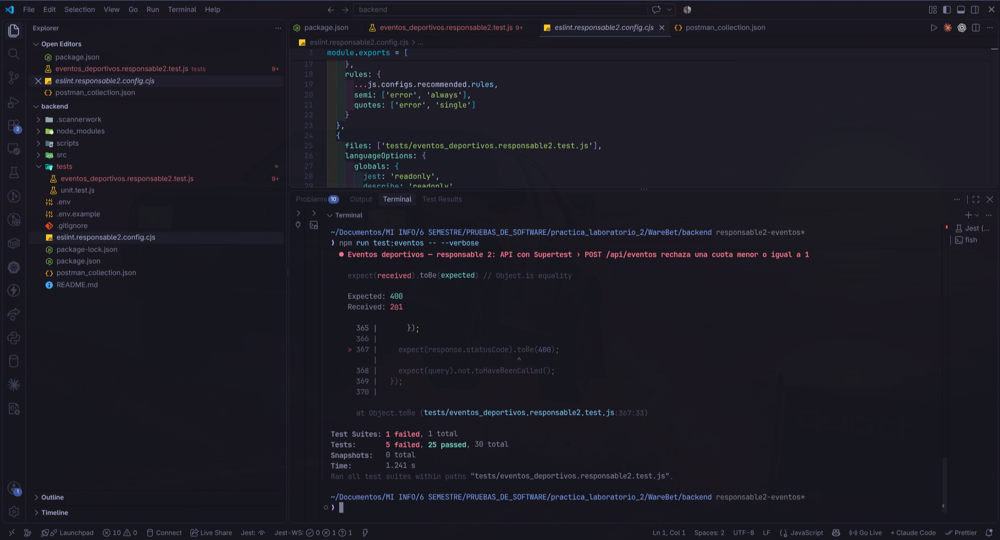
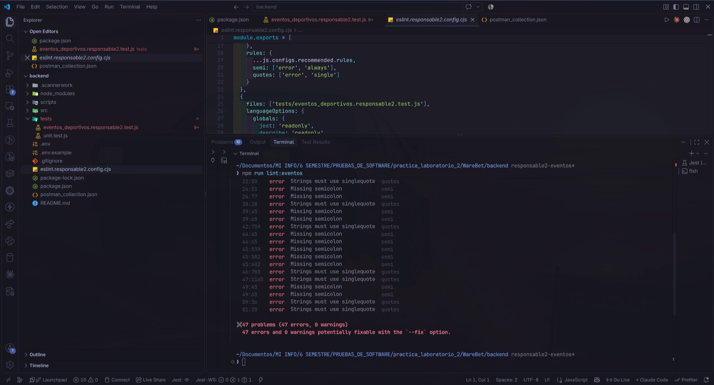
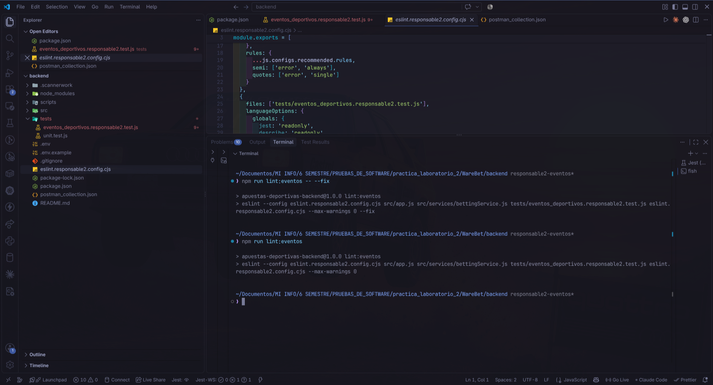
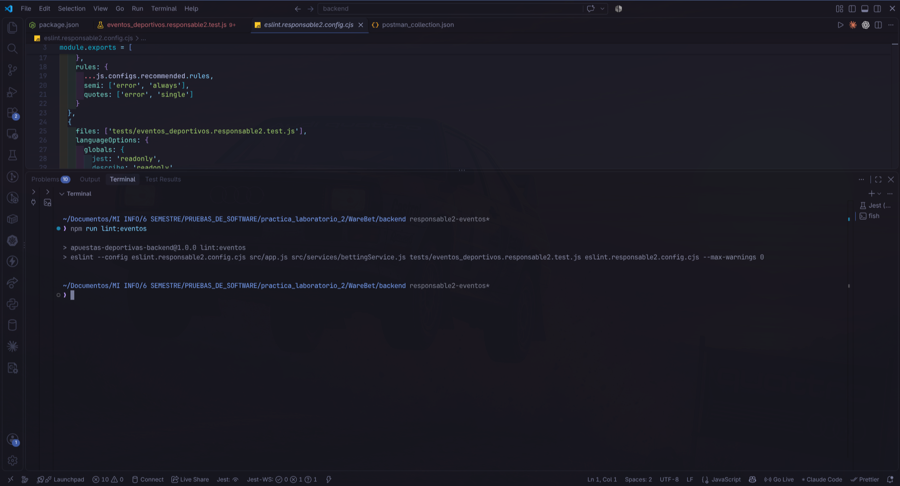
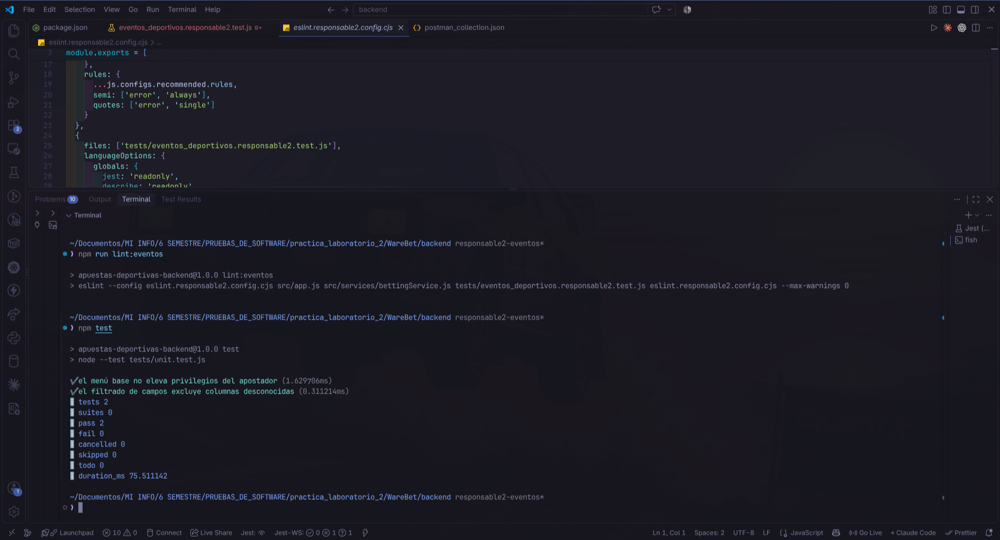

# Corrección de hallazgos relacionados con `eventos_deportivos`

## Alcance y resultado

- **Proyecto:** `WareBet`.
- **Responsable:** 2 — tabla `eventos_deportivos`, recurso `/api/eventos`.
- **Revisión:** 28 de octubre de 2026, en la rama `responsable2-eventos`, con commit base `007baaa`. Las correcciones de esta revisión están en el árbol de trabajo, pendientes de commit al redactar el informe.
- **Alcance funcional:** disponibilidad de eventos para selecciones, validación de marcadores, cálculo del resultado, CRUD HTTP de eventos, cuotas y permisos por perfil.
- **Herramientas:** Jest y Supertest para pruebas; ESLint para análisis de código; SonarQube local como revisión estática posterior.
- **Línea base funcional:** 30 casos ejecutados; 25 aprobados y 5 fallidos, después de ajustar las comparaciones de SQL de las pruebas.
- **Después de las correcciones:** 30 casos aprobados y 0 fallidos. Las 2 pruebas originales de `unit.test.js` también aprobaron.
- **Línea base de estilo:** ESLint reportó 47 errores y 0 advertencias; los 47 eran corregibles automáticamente. La revisión posterior no reportó hallazgos.
- **SonarQube posterior:** la captura del análisis suministrada por el responsable muestra 0 incidencias abiertas en seguridad, fiabilidad y mantenibilidad, 0 incidencias aceptadas y 0 hotspots. Muestra 581 líneas de código, duplicación de 0.0 % y cobertura de 0.0 %.

Se corrigieron dos defectos funcionales de eventos que provocaban cinco casos fallidos: cuatro entradas inválidas de marcadores y una cuota inválida al crear un evento. Además, se aplicaron las reglas de estilo utilizadas en clase. Los resultados de ejecución de este informe se respaldan en las capturas tomadas por el responsable; no se ejecutaron nuevamente las herramientas durante la redacción.

## Hallazgos corregidos

| Hallazgo | Herramienta y criterio | Ubicación | Código o comportamiento corregido | Tablas relacionadas |
|---|---|---|---|---|
| Marcadores inválidos aceptados | Jest: negativos, decimales, texto y valores no finitos deben rechazarse | `backend/src/services/bettingService.js`, función `setFinalEventResult`, líneas 50–59 | Validación de ambos marcadores como enteros no negativos antes de calcular y guardar el resultado | Eventos; la liquidación posterior también utiliza detalles y apuestas |
| Creación con cuota menor o igual a 1 | Jest/Supertest: `POST /api/eventos` debe responder `400` antes de persistir | `backend/src/app.js`, rama de creación de eventos, líneas 15–24 | Validación de las cuotas proporcionadas antes de `crud.insert` | Eventos |
| Comparaciones de SQL sensibles a espacios | Jest: falsos fallos en cuatro resultados válidos y una consulta por ID | `backend/tests/eventos_deportivos.responsable2.test.js` | Expresiones regulares que toleran espacios y mantienen la comprobación de consultas y parámetros | No modifica tablas ni código de producción |
| Comillas y puntos y coma | ESLint: reglas `quotes` y `semi`, además de reglas recomendadas | `backend/src/app.js` y `backend/src/services/bettingService.js`; el comando también revisa el test y la configuración | 47 errores de estilo corregidos mediante `--fix`; revisión posterior sin hallazgos | Archivos compartidos por eventos, usuarios, apuestas y detalles |

Las filas de esta tabla describen hallazgos de pruebas y de ESLint. No son identificadores de incidencias SonarQube ni se les asignan severidades de Sonar sin evidencia individual.

### 1. Validación de marcadores antes de calcular el resultado

La función `setFinalEventResult` comprobaba únicamente si alguno de los marcadores era nulo o estaba ausente. Por ello podía calcular un resultado con valores negativos, decimales, texto o `NaN`. En las pruebas se esperaba el rechazo con estado `400`, pero la operación terminaba sin error.

Se añadió una validación para ambos marcadores:

```javascript
const marcadores = [event.marcador_local, event.marcador_visitante];
if (marcadores.some((marcador) => !Number.isInteger(marcador) || marcador < 0)) {
  throw fail('Los marcadores deben ser enteros no negativos');
}
```

La validación se ejecuta cuando el evento está `FINALIZADO` y todavía no tiene un resultado guardado. Si falla, el servicio conserva su manejo de `ROLLBACK` y liberación del cliente. Si los marcadores son válidos, continúa determinando `LOCAL`, `VISITANTE` o `EMPATE`. Un evento cancelado no necesita marcadores y un resultado ya guardado conserva el comportamiento anterior.

### 2. Validación de cuotas al crear eventos

La edición con `PATCH /api/eventos/:id` ya rechazaba cuotas inválidas, pero la creación con `POST /api/eventos` no tenía esa comprobación. Supertest detectó que una solicitud con `cuota_local: 1` devolvía `201` cuando debía responder `400`.

Se revisan ahora los campos permitidos `cuota_local`, `cuota_empate` y `cuota_visitante` antes de insertar. Cada cuota proporcionada se convierte a número y debe ser finita y mayor que 1. Si alguna no cumple la condición, se responde:

```json
{"error":"Las cuotas deben ser mayores que 1"}
```

La respuesta utiliza estado `400` y no se ejecuta la consulta de inserción. La corrección está condicionada a `resource === 'eventos'`, por lo que no añade esa validación a los demás recursos. Se conserva la validación existente de edición.

Esta comprobación valida las cuotas proporcionadas; no incorpora una validación completa de campos obligatorios ni cambia el esquema de PostgreSQL.

### 3. Ajuste de las pruebas y organización del trabajo

Las pruebas están en un único archivo exclusivo del responsable 2: `backend/tests/eventos_deportivos.responsable2.test.js`, junto al archivo original `unit.test.js`. No se crearon carpetas adicionales de pruebas.

Las primeras comparaciones exigían espacios concretos en el SQL, por ejemplo `resultado = $1`, mientras que el repositorio utilizaba `resultado=$1`. Eso provocaba cinco falsos fallos: cuatro cálculos de resultados válidos y la consulta HTTP por ID. Se sustituyeron esas comparaciones por expresiones regulares que aceptan diferencias de espacios sin omitir la comprobación de los parámetros.

Por este motivo, el resultado preliminar de 20 aprobadas y 10 fallidas no se presenta como diez defectos del backend. La línea base válida para las correcciones funcionales fue de 25 aprobadas y 5 fallidas.

La batería definitiva contiene:

| Grupo | Casos | Comprobaciones |
|---|---:|---|
| Resultados del servicio | 15 | Ganador local, visitante y empates; marcadores inválidos; estados no liquidables; evento inexistente; cancelación; conservación de resultado guardado y manejo transaccional en los casos preparados |
| Disponibilidad de eventos | 3 | Rechazo de selecciones sobre eventos finalizados, cancelados o inexistentes |
| API con Supertest | 12 | Listado vacío y con datos, consulta por ID, creación, cuotas en creación/edición, eliminación, ausencia de autenticación y denegación de escritura al perfil APOSTADOR |
| **Total** | **30** | **Todos aprobados en la ejecución final** |

### 4. Reglas de ESLint y correcciones automáticas

Se creó `backend/eslint.responsable2.config.cjs` siguiendo las reglas del ejemplo de clase:

```javascript
...js.configs.recommended.rules,
semi: ['error', 'always'],
quotes: ['error', 'single']
```

La configuración utiliza CommonJS y declara las variables globales de Jest para revisar correctamente el archivo de pruebas. Se permite el prefijo `_` en argumentos intencionalmente sin uso, como `_nombre`, sin desactivar la regla de variables no utilizadas.

El comando revisa `src/app.js`, `src/services/bettingService.js`, el test del responsable 2 y su configuración ESLint. La primera ejecución reportó 47 errores y 0 advertencias. Se ejecutó `npm run lint:eventos -- --fix` y luego `npm run lint:eventos`; la salida final no reportó hallazgos.

Como `app.js` y `bettingService.js` son compartidos, el arreglo automático también cambió comillas y puntos y coma en funciones de usuarios, apuestas y detalles. Esos cambios corresponden a estilo y deben revisarse al integrar el trabajo; no se atribuyen al responsable 2 correcciones funcionales nuevas de las otras tablas.

## Hallazgos que se dejaron fuera

- No se modificaron las reglas de saldos, cálculo de pagos, cantidades de selecciones ni propiedad de apuestas. Los cambios funcionales se limitaron a los marcadores del evento y las cuotas al crearlo.
- La tabla de resultados de Jest no representa una cobertura exhaustiva del backend. No se probaron todas las combinaciones de permisos, notificaciones Socket.IO, liquidaciones con apuestas reales ni concurrencia.
- PostgreSQL está simulado mediante `jest.mock('../src/config/db')`. Supertest ejecuta las rutas y el repositorio con consultas simuladas; no demuestra que los registros se hayan almacenado en Neon.
- La función `jwt.verify` está simulada. Se comprueba el rechazo de solicitudes sin autenticación y los permisos de escritura del perfil APOSTADOR, pero no la firma, expiración ni interpretación completa del token real.
- El resumen nuevo de SonarQube no permite identificar qué claves históricas se cerraron por este trabajo. Los conteos de informes anteriores corresponden a otros análisis y no se suman ni se atribuyen como correcciones propias.
- La captura de SonarQube muestra cobertura de 0.0 %. La aprobación de 30 pruebas no equivale a cobertura del 100 % ni acredita la importación de un informe de cobertura. La imagen no muestra el resultado completo del Quality Gate, por lo que no se declara aprobado.

## Verificación

El responsable ejecutó desde `backend`:

```bash
npm run test:eventos -- --verbose
npm run lint:eventos
npm test
```

| Revisión | Antes | Después |
|---|---|---|
| Jest y Supertest de eventos | 25 aprobadas, 5 fallidas | 30 aprobadas, 0 fallidas |
| ESLint en los archivos configurados | 47 errores, 0 advertencias | Sin errores ni advertencias reportados |
| Pruebas originales con `node:test` | Archivo original conservado | 2 aprobadas, 0 fallidas |
| SonarQube posterior | No se usa un conteo histórico como base comparable de esta batería | Captura con 0 incidencias abiertas en seguridad, fiabilidad y mantenibilidad; 0 hotspots |

Las dependencias de desarrollo se registran en `backend/package.json` y `backend/package-lock.json`: Jest, Supertest, ESLint y `@eslint/js`. El comando `test:eventos` selecciona únicamente el archivo del responsable 2; `npm test` conserva la ejecución de las dos pruebas originales. `lint:eventos` aplica la configuración específica con `--max-warnings 0`.

El análisis posterior de SonarQube fue ejecutado por el responsable después de las correcciones. Se registra el resultado visible en su captura, sin afirmar una consulta directa a la API de SonarQube ni un cierre individual de claves históricas.

Dashboard: [WareBet en SonarQube](http://localhost:9000/dashboard?id=WareBet).

## Evidencias

Las capturas se conservan en `evidencias_responsable2_eventos_deportivos`, desde la raíz del proyecto. La carpeta `correccion de errores` contiene únicamente los informes Markdown. Sus nombres llevan un número de dos dígitos y una descripción separados por guiones bajos. La secuencia sigue la preparación, los diagnósticos, las correcciones automáticas y las verificaciones finales. Las capturas históricas de la carpeta `sonarqube` permanecen sin cambios.

### 01. Estado inicial del proyecto

Rama `responsable2-eventos`, árbol de trabajo inicialmente limpio y versiones de Node.js y npm.



### 02. Instalación de Jest, Supertest y ESLint

Instalación de Jest, Supertest y ESLint como dependencias de desarrollo, siguiendo la instrucción de clase.



### 03. Resultados iniciales de Jest y Supertest

Línea base funcional después de ajustar las comparaciones SQL: 25 pruebas aprobadas y 5 fallidas. El detalle visible muestra la creación con cuota inválida devolviendo `201` en lugar de `400`.



### 04. Errores iniciales de ESLint

Revisión inicial de ESLint: 47 errores, 0 advertencias y 47 errores potencialmente corregibles con `--fix`.



### 05. Corrección automática de ESLint

Ejecución de las correcciones automáticas de ESLint y revisión posterior sin mensajes de hallazgos. Esta etapa corrige estilo; los defectos funcionales se resolvieron después.



### 06. Jest y Supertest: 30 pruebas aprobadas

Ejecución de Jest y Supertest después de corregir las validaciones: 30 pruebas aprobadas de 30.


### 07. Verificación final de ESLint

Revisión final de ESLint después de las correcciones funcionales, sin errores ni advertencias reportados.



### 08. Pruebas originales aprobadas

Ejecución de las pruebas originales: 2 aprobadas y 0 fallidas.



### 09. Resultado final de SonarQube

Resumen del análisis posterior de SonarQube suministrado por el responsable: 0 incidencias abiertas en las tres categorías visibles y 0 hotspots. La cobertura sigue mostrando 0.0 %.


